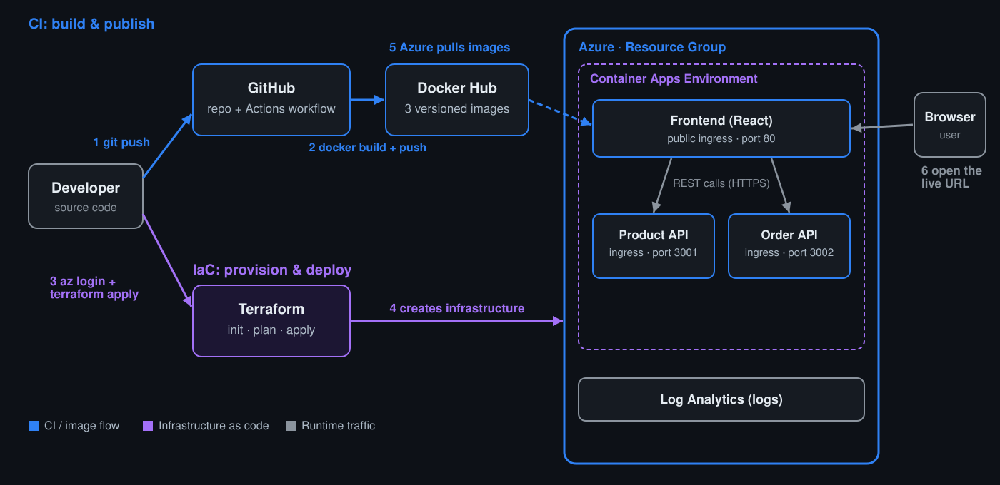

# infra
Terraform for the "Beyond Localhost" demo: resource group, Log Analytics, Azure Container Apps environment and three container apps (frontend, product API, order API) that pull public images from Docker Hub.



Related repos: `product-service`, `order-service`, `frontend` (each builds its own Docker Hub image with GitHub Actions).

## Use
```bash
az login
cp terraform.tfvars.example terraform.tfvars   # set dockerhub_user and image_tag (short SHA or latest)
terraform init
terraform plan
terraform apply        # prints frontend_url, product_api_url, order_api_url
terraform destroy      # clean up
```
Requires the Azure providers `Microsoft.App` and `Microsoft.OperationalInsights` to be registered, and the three Docker Hub repositories to be public.

State can contain secrets and is git-ignored; use remote state (Azure Storage) for teams.
